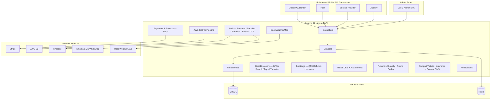

# BoatBnB — System Architecture

Large multi-role boat-rental marketplace: Laravel 12 API + Vue 3 admin SPA, with role-based mobile API surfaces for guests, hosts, agencies, and service providers.

## Layers

| Layer | Responsibility |
|-------|----------------|
| Mobile role APIs | Guest, host, agency, service_provider route groups |
| Admin SPA | Users, boats, bookings, promo codes, analytics |
| Services / Repositories | Business logic and data access separation |
| Integrations | Stripe, S3, Firebase, Smsala, OpenWeatherMap |
| Security / Ops | Rate limits, DDoS/IP middleware, nginx/fail2ban, Docker Sail |

## End-to-end ownership

Requirements → DB design → Layered Laravel API → Vue 3 admin → Role-based mobile APIs → Integrations → Security hardening → Docker deployment → Production support
